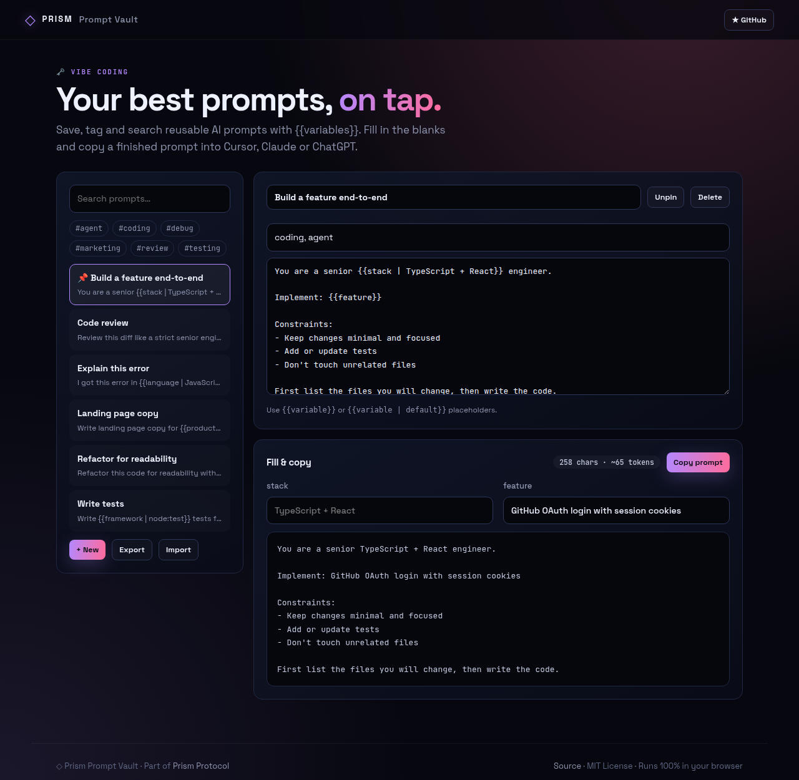
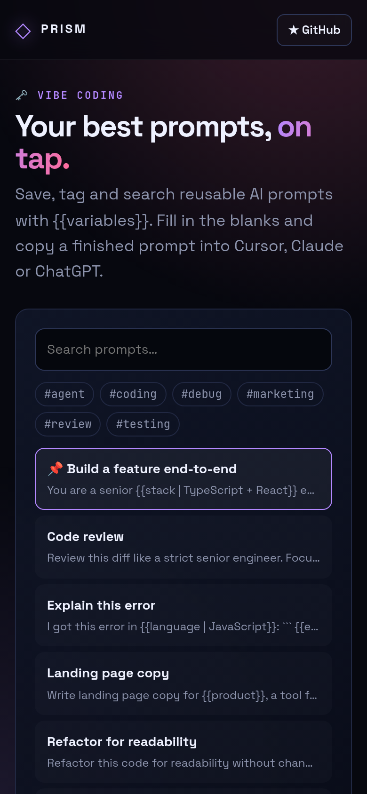

<!-- ═════════════ HEADER ═════════════ -->
<p align="center">
  
</p>

<p align="center">
  
</p>

<p align="center">
  <a href="https://github.com/krishyaa06/prism-prompt-vault/actions/workflows/ci.yml"></a>
  <a href="https://krishyaa06.github.io/prism-prompt-vault/"></a>
  
  
  <a href="LICENSE"></a>
</p>

<p align="center">
  
</p>


## ⚡ Overview

**Prism Prompt Vault** keeps the prompts you reuse every day in one place. Write templates with `{{variable}}` or `{{variable | default}}` placeholders, and the vault builds a fill-in form, shows the finished prompt with a token estimate, and copies it in one click. Prompts can be tagged, pinned, searched and ranked by how often you use them. Everything is saved in your browser and can be exported or imported as JSON.

## ✨ Features

- **Templates** with `{{var}}` and `{{var | default}}` placeholders
- **Auto-generated form** — multiline inputs for code/diff/error variables
- **Live preview** with character + token estimate, one-click copy
- **Tags, pins and search**; frequently used prompts rise to the top
- **Starter pack** of coding prompts (feature build, review, tests, debugging)
- **JSON import/export** — share a pack with your team

## 📸 Screenshots

<table>
  <tr>
    <td width="68%"></td>
    <td width="32%"></td>
  </tr>
</table>

## 🚀 Quick Start

**Use it online:** [https://krishyaa06.github.io/prism-prompt-vault/](https://krishyaa06.github.io/prism-prompt-vault/)

**Run locally:**

```bash
git clone https://github.com/krishyaa06/prism-prompt-vault.git
cd prism-prompt-vault
# open index.html in your browser, or serve it:
npx serve .
```

## 🛠️ Usage

1. Pick a prompt from the list or click **+ New**.
2. Edit the template; placeholders appear as form fields.
3. Fill them in and hit **Copy prompt**.

Share a pack with **Export** and load one with **Import**.

## 📁 Project Structure

```text
prism-prompt-vault/
├── assets/
│   ├── logo.png
│   └── logo.svg
├── css/
│   ├── app.css
│   └── prism.css
├── js/
│   ├── app.js   # library UI
│   ├── core.js   # template engine, search, import/export — tested in Node
│   └── prism.js
├── test/
│   └── core.test.js
├── .gitignore
├── LICENSE
├── README.md
├── index.html
└── package.json
```

## 🧪 Tests

```bash
npm test
```

Tests use the built-in `node:test` runner, so there is nothing to install. CI runs them on Node 20 and 22.

## 🤝 Contributing

1. Fork the repo and create a branch: `git checkout -b feature/my-idea`
2. Make your change and add a test in `test/`
3. Run `npm test` and open a Pull Request

## 🔷 Part of Prism Protocol

Prism Prompt Vault is one of the open-source tools built by [Prism Protocol](https://dc.gg/prismprotocol), a tech community where young builders learn, ship and compete together.

## 👤 Author

<table>
  <tr>
    <td align="center">
      <a href="https://github.com/krishyaa06"><br><b>Soumya Bhandare</b></a><br>
      <sub>Founder @ Prism Protocol</sub>
    </td>
    <td>
      <a href="https://dc.gg/prismprotocol"></a><br>
      <a href="https://instagram.com/prism_protocol_"></a><br>
      <a href="https://x.com/krishyaa06"></a>
    </td>
  </tr>
</table>

## 📄 License

Released under the [MIT License](LICENSE).

<p align="center">
  <b>If you like this project, consider giving it a ⭐</b><br>
  <sub>"Build. Create. Compete." · Made with ⚡ by Prism Protocol</sub>
</p>


